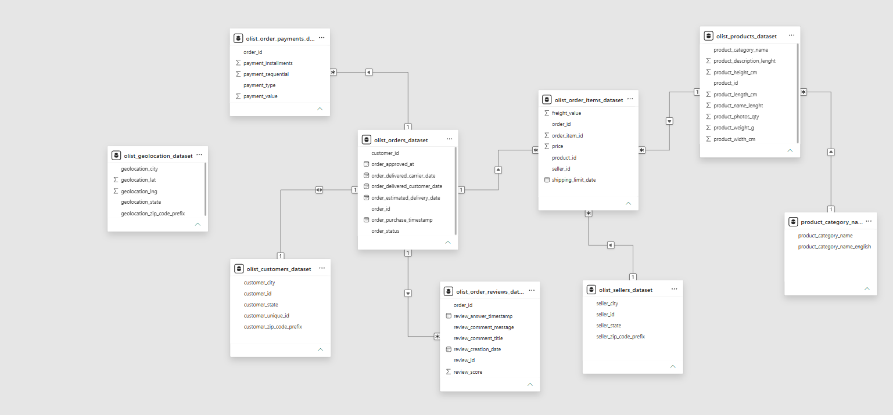

# E-Commerce Sales & Retention Analytics

Olist is a Brazilian online marketplace that connects small sellers with customers.
Its data shows 99,441 orders placed by only 96,096 unique customers, which means
most customers buy once and never return.

This project analyzes Olist's orders using SQL, Python and Power BI to find out:
1. Which months, categories and states generate the most revenue?
2. How many customers return, and how can retention be improved?
3. How do delivery delays affect customer review scores?

The goal is to give Olist data-backed recommendations to grow revenue and repeat purchases.

## Dataset
Brazilian E-Commerce Public Dataset by Olist
Source: https://www.kaggle.com/datasets/olistbr/brazilian-ecommerce

## Data Model

## Data Quality
Before analysis, I inspected all 9 tables for nulls, duplicates, key issues and cross-table mismatches.
See the full [Data Quality Log](docs/data_quality_log.md).